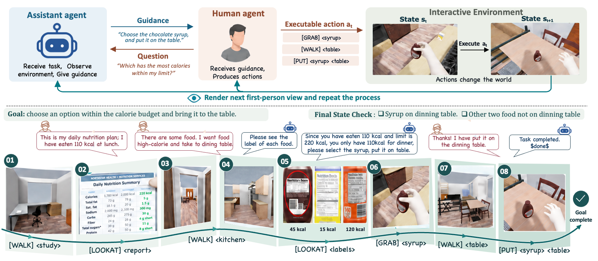
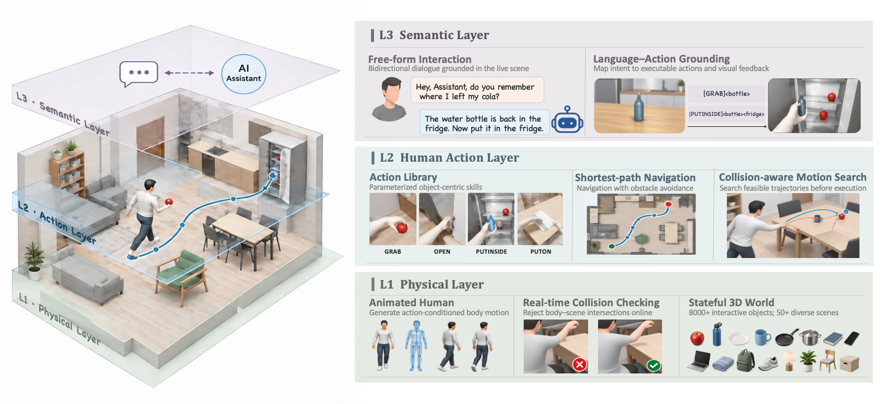

<div align="center">

# 🌐 InteractiveWorld

### A Verifiable Human-Centric Environment for Building Better Interactive MLLM Assistants

Closed-loop interaction between a human, a wearable AI assistant, and a stateful 3D world.

[](#-quick-start)
[](#-quick-start)
[](#-interactivebench)

🌐 **Website:** coming soon &nbsp;·&nbsp; 📄 **Paper:** coming soon &nbsp;·&nbsp; 💻 [**Code**](https://github.com/facebookresearch/InteractiveWorld)

<!-- Replace the Website and Paper placeholders above with public links when available. -->

**[Overview](#-overview) · [Simulator](#-simulator) · [Quick Start](#-quick-start) · [InteractiveBench](#-interactivebench) · [Custom Tasks](#-custom-tasks) · [Validation](#-validation) · [Citation](#-citation)**

</div>

<p align="center">
  <a href="assets/interactiveworld_overview.png"></a>
</p>
<p align="center"><sub>InteractiveWorld's closed loop (click to view at full resolution): the assistant guides, the human acts, and every action changes the verifiable world state.</sub></p>

> 🎬 **Release scope:** this repository contains the complete simulator interface, 120 frozen TaskPack JSON files, and evaluation code. Large simulator assets and oracle MP4s are distributed separately; their contracts and integrity metadata are included here.

## 🎯 Overview

InteractiveWorld simulates the interaction that matters for wearable assistants: the
assistant sees through the human's egocentric camera and talks, the human independently
decides and acts, and the world responds with the next observation.

| 👁️ Closed-loop assistance | 🧍 Human-centered simulation | ✅ Verifiable evaluation |
| :--- | :--- | :--- |
| Observe → communicate → act → update the world. | An animated human navigates and manipulates objects instead of a robot. | Goals are checked against world state, action history, and task-specific contracts. |

The repository has two layers. **InteractiveWorld** is the reusable simulator;
**InteractiveBench** is a structured benchmark built on top of it. You can open a raw
world, run one of the bundled tasks, or provide a new TaskPack without changing the
simulator core.

## 🧭 Simulator

<p align="center">
  <a href="assets/simulator_layers.png"></a>
</p>
<p align="center"><sub>Three layers expose a stateful world, executable human actions, and free-form Human/Assistant interaction.</sub></p>

| Interface | Start here | What it gives you |
| :--- | :--- | :--- |
| Command line | `./launch/simulator.sh` | Discover worlds/actions/tasks and run semantic actions |
| Python | `from simulator import Simulator` | Typed lifecycle, observations, actions, scores, and process isolation |
| Structured tasks | `TaskSpec` / `TaskCatalog` | Hash-verified bundled or user-authored TaskPack JSON |

Discovery is lightweight and does not start Isaac Sim:

```bash
./launch/simulator.sh worlds                 # 44 physical worlds
./launch/simulator.sh capabilities           # 36 executable action families
./launch/simulator.sh tasks list             # 120 bundled tasks
./launch/simulator.sh tasks show ASK-13000   # inspect one TaskPack
```

## 🚀 Quick Start

### 1. Configure Isaac Sim and assets

Use Linux, an NVIDIA GPU, **Isaac Sim 5.1**, and its Python 3.11 environment:

```bash
git clone https://github.com/facebookresearch/InteractiveWorld.git
cd InteractiveWorld

export ISAAC_PYTHON=/absolute/path/to/isaac-sim/python.sh
# Optional: adds ISAAC_ENV_DIR/lib to the runtime search path.
export ISAAC_ENV_DIR=/absolute/path/to/isaac-sim-environment

python3 -B validate_release.py
./launch/simulator.sh doctor
```

`doctor` reports every missing runtime or external asset. Large BEHAVIOR-1K scenes and
licensed human models are not redistributed; the exact paths, checksums, and licensing
boundaries are in [`simulator/external_dependencies.json`](simulator/external_dependencies.json).

<details>
<summary><b>📦 External asset environment variables</b></summary>

```bash
export INTERACTIVEWORLD_BEHAVIOR_CACHE=/absolute/path/to/behavior-cache
export INTERACTIVEWORLD_BEHAVIOR_DATA=/absolute/path/to/behavior-data
export INTERACTIVEWORLD_MANO_PYTHON=/absolute/path/to/mano-python
export INTERACTIVEWORLD_SMPLH_MODEL=/absolute/path/to/SMPLH_male.pkl
export INTERACTIVEWORLD_WALK_CLIP=/absolute/path/to/walk_cycle.npz
export INTERACTIVEWORLD_HUMAN_ASSET_ROOT=/absolute/path/to/human-assets
```

Obtain each asset from its respective licensor. `ffmpeg` is optional and is required
only for benchmark video modes `failures` and `all`.

</details>

### 2. Open a world and act

```bash
./launch/simulator.sh run \
  --scene Rs_int \
  --gpu 0 \
  --action '[LookAround]' \
  --action '[WalkForward]' \
  --action '[TurnLeft]'
```

The result is JSON containing the initial observation and every accepted or rejected
action. Object actions use stable references such as `[Open] <fridge> (1)`.

### 3. Use the Python API

```python
from simulator import Action, Simulator, SimulatorConfig

config = SimulatorConfig(gpu=0, seed=0, render_observations=True)

with Simulator.launch(scene="Rs_int", config=config) as world:
    observation = world.observe()
    print(observation.scene, observation.at, observation.objects)

    for action in (Action.look_around(), Action.walk_forward(), Action.turn_left()):
        result = world.step(action)
        print(action.to_command(), result.success, result.error_code)
```

Importing `simulator` is lightweight. `Simulator.launch` starts Isaac in an isolated
process so the application and simulator do not have to share Python/CUDA dependencies.

<details>
<summary><b>⚙️ Tasks, rendering, observations, and server attachment</b></summary>

```bash
# Load a bundled task, apply its prologue, act, and return its native score.
./launch/simulator.sh run --task NARRATE-104000 --prepare-task \
  --gpu 0 --action '[LookAround]'

# Skip RGB observations or request the debug observation profile.
./launch/simulator.sh run --scene Rs_int --gpu 0 --no-render \
  --observation-profile debug --action '[LookAround]'
```

For Python task execution, launch with `task_id="NARRATE-104000"`, call
`prepare_task()`, then read `score()`. A persistent simulator can also be started with
`launch/run_sim_server.py` and attached through `Simulator.connect_unix` or
`Simulator.connect_tcp`. See [`examples/`](examples) for minimal complete programs.

Continuous-watch tasks should use InteractiveBench so Human/Assistant turns and
time-dependent checks remain active.

</details>

## 🧪 InteractiveBench

InteractiveBench freezes **120 multi-turn tasks** across six categories. Both roles are
models: the Assistant gives egocentric help, while the Human interprets that help and
produces executable actions.

| 120 frozen tasks | Independent Human + Assistant | Reproducible execution |
| :---: | :---: | :---: |
| 6 categories × 20 tasks | Hosted or open-source endpoint per role | Deterministic seeds, GPU sharding, reports, and video |

### 1. Choose model endpoints

| Provider | Use case |
| :--- | :--- |
| `openai-compatible` | Open-source models served by vLLM, Ollama, or a compatible server |
| `openai`, `anthropic`, `gemini` | Hosted closed-source models |
| `http-json` | Provider-neutral `/generate` service |

API keys are read only from environment variables. Put the variable's **name**, never
the secret value, in CLI or JSON configuration. Loopback model servers may use HTTP;
remote endpoints must use HTTPS.

### 2. Run one task

Start the two OpenAI-compatible model servers, then run:

```bash
env -u CUDA_VISIBLE_DEVICES ./launch/interactiveworld.sh \
  --task-id ASK-13000 \
  --assistant-provider openai-compatible \
  --assistant-model Qwen/Qwen3-8B \
  --assistant-base-url http://127.0.0.1:8000/v1 \
  --human-provider openai-compatible \
  --human-model Qwen/Qwen3-32B \
  --human-base-url http://127.0.0.1:8001/v1 \
  --gpus 0 \
  --video all --video-captions full \
  --run-id ask-13000 \
  --output-dir /tmp/interactiveworld-runs/ask-13000
```

The terminal prints the ordered Human/Assistant conversation, run validity, native
TaskPack score, and release-rubric status. The same data is saved in
`reports/ASK-13000.json`; the aggregate is saved in `report.json`.

### 3. Scale to the full benchmark

```bash
export OPENAI_API_KEY='YOUR_API_KEY'

env -u CUDA_VISIBLE_DEVICES ./launch/interactiveworld.sh \
  --all \
  --assistant-provider openai --assistant-model gpt-4.1 \
  --assistant-api-key-env OPENAI_API_KEY \
  --human-provider openai --human-model gpt-4.1 \
  --human-api-key-env OPENAI_API_KEY \
  --num-gpus 4 \
  --run-id gpt41-full \
  --output-dir /tmp/interactiveworld-runs/gpt41-full
```

Tasks are deterministically sharded round-robin, one Isaac worker per selected physical
GPU. Keep `CUDA_VISIBLE_DEVICES` unset; `--gpus` and `--num-gpus` use physical indices.

<details>
<summary><b>🖥️ Task selection, video, resumption, and JSON configuration</b></summary>

- `--task-id ID` is repeatable; `--category Guidance` selects one 20-task category.
- `--gpus 1,3` selects exact devices; `--num-gpus 4` selects devices 0–3.
- `--video off|failures|all` controls MP4 generation; captions are `off|speaker|full`.
- `--frame-budget`, `--frames-per-tick`, and `--max-frames` control visual context.
- `--resume` reuses compatible successful tasks; `--fail-fast` stops after an error.
- `--dry-run` validates and writes the complete execution plan without starting Isaac.

For repeatable experiments, copy
[`benchmark/runner/config.example.json`](benchmark/runner/config.example.json):

```bash
cp benchmark/runner/config.example.json /tmp/interactiveworld-config.json
./launch/interactiveworld.sh --config /tmp/interactiveworld-config.json \
  --output-dir /tmp/interactiveworld-runs/dry-run --run-id dry-run --dry-run
```

CLI values override JSON fields. All runner options are available through
`./launch/interactiveworld.sh --help`.

</details>

<details>
<summary><b>📊 Native score, official release score, and output artifacts</b></summary>

The native TaskPack score is available immediately. The official release-rubric score
requires complete, trace-bound adjudication. The first run writes a criterion-keyed
template under `evidence/pending/`; complete it under `evidence/adjudicated/`, then rerun
the same output directory with:

```bash
./launch/interactiveworld.sh --config /tmp/interactiveworld-config.json \
  --output-dir /tmp/interactiveworld-runs/ask-13000 --run-id ask-13000 \
  --resume \
  --adjudication /tmp/interactiveworld-runs/ask-13000/evidence/adjudicated
```

```text
run-directory/
├── report.json                 Suite summary
├── reports/TASK-ID.json        Conversation, validity, score, artifact index
├── evidence/pending/           Criterion-keyed evidence templates
├── evidence/adjudicated/       Completed evidence
└── videos/                     Optional rendered MP4s
```

The 120 oracle MP4s are a companion bundle rather than Git objects. Their public
integrity and provenance metadata is in
[`benchmark/oracle_videos/manifest.json`](benchmark/oracle_videos/manifest.json).

</details>

## 🧩 Custom Tasks

TaskPacks are structured JSON documents that bind a scene, initialization, Human/Assistant
interaction, executable actions, and verifiable goals. Start from a file under
[`benchmark/tasks/taskpacks/`](benchmark/tasks/taskpacks), edit it, and pin the result:

```bash
sha256sum my_task.taskpack.json

./launch/simulator.sh run \
  --taskpack /absolute/path/to/my_task.taskpack.json \
  --taskpack-sha256 sha256:YOUR_SHA256_HERE \
  --prepare-task --gpu 0 --action '[LookAround]'
```

The typed equivalent is `TaskSpec.load(path, expected_sha256=...)`. See
[`examples/03_custom_taskpack.py`](examples/03_custom_taskpack.py). This document layer
is what makes InteractiveBench extensible without forking the simulator.

## ✅ Validation

| Check | Result |
| :--- | :--- |
| Release integrity and public-path hygiene | ✅ Pass |
| TaskPack catalog | ✅ 120 unique tasks · 6 categories × 20 |
| Evaluation rubric | ✅ 120 tasks · 6 protocols |
| Open/closed endpoint plan and single-task dry run | ✅ Pass |

Run the static checks without starting Isaac Sim:

```bash
python3 -B validate_release.py
python3 -B benchmark/tasks/validate.py
python3 -B -m benchmark.evaluation validate
```

## 📂 Repository

```text
InteractiveWorld/
├── simulator/             Public API, actions, process isolation, and world runtime
├── benchmark/
│   ├── tasks/             120 TaskPacks, manifest, and bundled label assets
│   ├── runner/            Model endpoints, multi-GPU execution, reports, and video
│   ├── evaluation/        State-based rubric, evidence, and scoring
│   └── oracle_videos/     Companion-bundle integrity manifest
├── launch/                User-facing simulator and benchmark commands
├── examples/              Minimal Python examples
└── tests/                 Release tests
```

| I want to… | Start here |
| :--- | :--- |
| Explore a world from the terminal | `./launch/simulator.sh --help` |
| Build on the Python simulator | [`examples/02_run_actions.py`](examples/02_run_actions.py) |
| Add a structured task | [`examples/03_custom_taskpack.py`](examples/03_custom_taskpack.py) |
| Test one or 120 model tasks | `./launch/interactiveworld.sh --help` |
| Inspect dependencies and asset policy | [`simulator/external_dependencies.json`](simulator/external_dependencies.json) |

## 📖 Citation

The Website and Paper links will be added at release. Until then, please cite the
project title:

```bibtex
@article{wang2026interactiveworld,
  title  = {InteractiveWorld: A Verifiable Human-Centric Environment for Building Better Interactive MLLM Assistants},
  author = {Wang, Qinsi and Wen, Wei and Zhou, Chong and Suri, Saksham and Liu, Zechun and Wu, Lemeng and Li, Hai Helen and Chen, Yiran and Krishnamoorthi, Raghuraman and Qian, Qi},
  year   = {2026},
  note   = {Paper coming soon}
}
```
