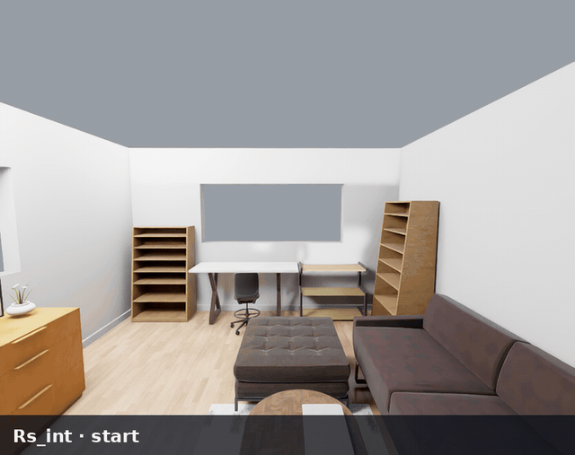

<div align="center">

# InteractiveWorld

### A Verifiable Human-Centric Environment for Building Better Interactive MLLM Assistants

<a href="https://meta-interactiveworld.github.io/"></a>&nbsp;
&nbsp;
<a href="https://github.com/facebookresearch/InteractiveWorld"></a>

**[Overview](#-overview) · [InteractiveWorld](#-interactiveworld) · [InteractiveBench](#-interactivebench) · [Citation](#-citation)**

</div>

## 🎯 Overview

InteractiveWorld simulates the interaction that matters for wearable AI assistants: the
assistant sees through a person's eyes and talks, the person decides and acts, and a
stateful 3D world responds with the next first-person view.

| 👁️ Closed-loop assistance | 🧍 Human-centered simulation | ✅ Verifiable evaluation |
| :--- | :--- | :--- |
| Observe → communicate → act → update the world. | An animated human walks, grasps, opens and uses objects in 44 BEHAVIOR-1K homes and venues. | Goals are checked against the world state, not judged from text. |

The repository has two layers. **InteractiveWorld** is the reusable simulator: open a
scene and drive the human with short commands such as `[Grab] <cup> (1)`.
**InteractiveBench** builds 120 frozen multi-turn tasks on top of it, where one model
plays the assistant and another plays the human.

### Repository structure

```text
InteractiveWorld/
├── simulator/              InteractiveWorld simulator
│   ├── api.py              Python API: Simulator, Action, Observation, Score
│   ├── physical_world/     Isaac Sim scenes, human motion, manipulation, rendering, BEHAVIOR baking
│   ├── environment/        Persistent environment: reset, step, observe, native score
│   ├── interaction/        Human/Assistant turn protocol and prompts
│   ├── human_model/        SMPL+H skinning and the bundled grasp atlas
│   └── world_catalog/      44 admitted scenes and the BEHAVIOR asset manifest
├── benchmark/              InteractiveBench
│   ├── tasks/              120 frozen TaskPacks (6 categories × 20) and their manifest
│   ├── runner/             One-command evaluation: model endpoints, multi-GPU, reports, videos
│   ├── evaluation/         Release rubric, evidence and scoring
│   └── oracle_videos/      Integrity manifest of the 120 oracle videos
├── launch/                 Command-line entry points (prepare_assets, simulator, interactiveworld, ...)
├── examples/               Minimal Python programs
├── docs/                   Detailed guides
└── tests/                  Release tests
```

| Guide | Contents |
| :--- | :--- |
| [`docs/INSTALL.md`](docs/INSTALL.md) | Every download, what the preparation step produces, environment variables, troubleshooting |
| [`docs/ACTIONS.md`](docs/ACTIONS.md) | All 36 human action families with their command forms and examples |
| [`docs/SIMULATOR.md`](docs/SIMULATOR.md) | Command line, Python API, observations, tasks and server mode |
| [`docs/BENCHMARK.md`](docs/BENCHMARK.md) | Evaluating models: providers, task selection, GPUs, outputs and scoring |
| [`docs/TASKPACK.md`](docs/TASKPACK.md) | The TaskPack format and how to build and run your own tasks |

## 🌍 InteractiveWorld

### 1. Preparation

InteractiveWorld runs on Linux with an NVIDIA GPU (we test on A100 80 GB; one simulator
worker uses about 4 GB of GPU memory) and needs about 100 GB of disk. You download four
things; one script then prepares everything else.

| What | Version | Where to get it | License |
| :--- | :--- | :--- | :--- |
| Isaac Sim + OmniGibson | 5.1 / 3.9.0 | [BEHAVIOR-1K installer](https://github.com/StanfordVL/BEHAVIOR-1K) (step 1) | NVIDIA Isaac Sim EULA |
| BEHAVIOR-1K scenes and objects | 3.9.0 (31 GB) | same installer, `--dataset` | BEHAVIOR Data License |
| SMPL+H body model | `mano_v1_2.zip` | [mano.is.tue.mpg.de](https://mano.is.tue.mpg.de) → Downloads → *Models & Code* | MANO license (registration) |
| ACCAD walking motion | `ACCAD.tar.bz2` | [amass.is.tue.mpg.de](https://amass.is.tue.mpg.de) → Downloads → ACCAD → *SMPL-X N* | AMASS license (registration) |

**Step 1 — Isaac Sim 5.1, OmniGibson and the BEHAVIOR-1K dataset.** The official
installer creates a conda environment named `behavior` and downloads the dataset to
`BEHAVIOR-1K/datasets`:

```bash
git clone -b v3.9.0 https://github.com/StanfordVL/BEHAVIOR-1K.git
cd BEHAVIOR-1K
./setup.sh --new-env --omnigibson --bddl --dataset \
    --accept-conda-tos --accept-nvidia-eula --accept-dataset-tos
conda activate behavior
cd ..
```

**Step 2 — InteractiveWorld.**

```bash
git clone https://github.com/facebookresearch/InteractiveWorld.git
cd InteractiveWorld
pip install -r requirements.txt
export ISAAC_PYTHON=$(which python)
```

**Step 3 — Human model files.** Register on the MANO and AMASS websites and download
`mano_v1_2.zip` and the ACCAD `SMPL-X N` archive (`ACCAD.tar.bz2`) from the table above.
Both are licensed for non-commercial research and cannot be redistributed.

**Step 4 — Prepare the assets.** This bakes the 6,831 BEHAVIOR objects used by the
release, copies the OmniGibson materials, converts the SMPL+H model, extracts the walk
clip, verifies every frozen checksum and writes an environment file:

```bash
./launch/prepare_assets.sh \
    --behavior-data ../BEHAVIOR-1K/datasets \
    --smplh ~/Downloads/mano_v1_2.zip \
    --accad ~/Downloads/ACCAD.tar.bz2 \
    --output ~/interactiveworld-assets \
    --workers 8

source ~/interactiveworld-assets/env.sh
./launch/simulator.sh doctor        # prints "ok": true when everything is in place
```

Baking takes about two minutes with eight workers. Add `source ~/interactiveworld-assets/env.sh`
to your shell profile; [`docs/INSTALL.md`](docs/INSTALL.md) lists every variable and common fixes.

### 2. Your first actions

Open a scene and give the human a sequence of commands. `--video` saves what the human
sees (requires `ffmpeg`), and the JSON on stdout reports the outcome of every action:

```bash
./launch/simulator.sh run --scene Rs_int --gpu 0 --frames-per-action 12 \
    --action '[Walk] <can_of_soda> (1)' \
    --action '[Grab] <can_of_soda> (1)' \
    --action '[Walk] <coffee_table_fqluyq_0> (1)' \
    --action '[Put] <can_of_soda> (1) <coffee_table_fqluyq_0> (1)' \
    --action '[Sit] <sofa_mnfbbh_0> (1)' \
    --video first_actions.mp4 > first_actions.json
```

<p align="center">
  
</p>

A command is `[Verb]` followed by object keys, each with an instance number. Run the
same command without `--action` to list the keys of a scene (`initial_observation.objects`).
The human works out where to stand, how to walk there and how to grip the object.

| Family | Commands |
| :--- | :--- |
| Move | `[Walk] <target> (1)` · `[Run]` · `[Forward]` · `[TurnLeft]` · `[TurnRight]` · `[TurnAround]` |
| Look | `[LookAt] <object> (1)` · `[LookAround]` · `[LookScan]` |
| Hands | `[Grab] <object> (1)` · `[Put] <object> (1) <surface> (1)` · `[PutInside] <object> (1) <container> (1)` · `[Drop]` |
| Articulate | `[Open]` · `[Close]` · `[OpenDoor]` · `[CloseDoor]` · `[TurnOn]` · `[TurnOff]` |
| Use tools | `[Cut] <target> (1) <tool> (1)` · `[Stir]` · `[Pour]` · `[Wipe]` · `[Cook]` · `[UseComputer]` · `[AnswerPhone]` |
| Body | `[Sit] <seat> (1)` · `[StandUp]` · `[Squat]` · `[Wait]` |

All 36 action families, their aliases and their rules are in [`docs/ACTIONS.md`](docs/ACTIONS.md);
`./launch/simulator.sh capabilities` prints the same catalog.

### 3. Simulator basics

Discovery commands start instantly and do not launch Isaac Sim:

```bash
./launch/simulator.sh worlds                 # 44 scenes
./launch/simulator.sh capabilities           # 36 action families
./launch/simulator.sh tasks list             # 120 bundled tasks
./launch/simulator.sh tasks show ASK-13000   # one TaskPack
```

The same simulator is available from Python. `import simulator` is lightweight;
`Simulator.launch` starts Isaac Sim in a separate process, so your application keeps its
own Python and CUDA environment:

```python
from simulator import Action, Simulator, SimulatorConfig

config = SimulatorConfig(gpu=0, frames_per_action=8)
with Simulator.launch(scene="Rs_int", config=config) as world:
    print(world.observe().objects)
    for action in (Action.walk("can_of_soda"), Action.grab("can_of_soda")):
        result = world.step(action)
        print(action.to_command(), result.success, result.error_code)
        frames = result.observation.frames_png      # first-person PNG frames
```

| To… | Use |
| :--- | :--- |
| Open a bundled task and apply its prologue | `./launch/simulator.sh run --task NARRATE-104000 --prepare-task --action ...` |
| Keep one simulator running and attach to it | `launch/run_sim_server.py` with `Simulator.connect_unix` / `Simulator.connect_tcp` |
| Read predicates and the native score | `SimulatorConfig(observation_profile="debug")`, `world.score()` |
| See complete programs | [`examples/`](examples) |

Everything else (observation fields, configuration, errors, the server protocol) is in
[`docs/SIMULATOR.md`](docs/SIMULATOR.md).

## 📊 InteractiveBench

InteractiveBench freezes **120 multi-turn tasks**, 20 in each of six categories:
**Guidance**, **Planning**, **Accessibility**, **Decision**, **Prevention** and
**Finding**. The model under test is the *Assistant*: it sees only the human's
first-person view and the dialogue. A second, fixed model is the *Human*: it follows the
Assistant's guidance by issuing simulator actions. A task passes when every goal holds in
the final world state.

### 1. Evaluate a model

One command selects the two models, the tasks and the GPUs. The Assistant and the Human
can each be a local open-source model behind an OpenAI-compatible server (vLLM, Ollama)
or a hosted API (`openai`, `anthropic`, `gemini`). API keys are read from the environment
variable you name, never from the command line.

```bash
# Serve an open-source model, for example: vllm serve Qwen/Qwen3-VL-8B-Instruct --port 8000
export GEMINI_API_KEY=...

env -u CUDA_VISIBLE_DEVICES ./launch/interactiveworld.sh \
    --assistant-provider openai-compatible \
    --assistant-model Qwen/Qwen3-VL-8B-Instruct \
    --assistant-base-url http://127.0.0.1:8000/v1 \
    --human-provider gemini \
    --human-model gemini-3.1-pro-preview \
    --human-api-key-env GEMINI_API_KEY \
    --category Guidance \
    --num-gpus 2 \
    --video failures \
    --output-dir runs/qwen3-vl-8b-guidance
```

| Option | Choices |
| :--- | :--- |
| Assistant (model under test) | `--assistant-provider` `openai-compatible`·`openai`·`anthropic`·`gemini`·`http-json`, `--assistant-model`, `--assistant-base-url`, `--assistant-api-key-env` |
| Human | the same `--human-*` options; the paper uses Gemini 3.1 Pro for every Assistant |
| Tasks | `--task-id ASK-13000` (repeatable), `--category Guidance` (repeatable), or all 120 by default |
| GPUs | `--num-gpus N` (GPUs 0…N−1) or `--gpus 1,3`; tasks are sharded round-robin, one Isaac worker per GPU |
| Output | `--output-dir`, `--video off\|failures\|all`, `--video-captions off\|speaker\|full`, `--resume` |
| Repeatable setup | `--config my_config.json`, starting from [`benchmark/runner/config.example.json`](benchmark/runner/config.example.json); command-line flags override it |
| Check before running | `--dry-run` prints the full execution plan without starting Isaac Sim |

The terminal prints each task's Human/Assistant conversation and result. The run
directory holds `report.json` (suite summary), `reports/<TASK-ID>.json` (conversation,
actions, score) and `videos/`. See [`docs/BENCHMARK.md`](docs/BENCHMARK.md) for every
option, the output files and the official release score.

### 2. Add your own task

A task is one **TaskPack** JSON file: the scene and the objects to place (`world`), the
final state that counts as success (`goal`), what the human did before asking
(`story.prologue`), how the human reacts to guidance (`runtime.human_policy`) and an
oracle solution (`runtime.oracle_commands`). The easiest start is to derive a new task
from a bundled one:

```bash
python3 examples/05_derive_taskpack.py /tmp/my_task.taskpack.json
# prints:  task_id  MY-ASK-12802-LIVINGROOM   sha256:<digest>
```

Check it by replaying its oracle solution in the simulator, then evaluate models on it:

```bash
./launch/simulator.sh run --taskpack /tmp/my_task.taskpack.json --taskpack-sha256 sha256:<digest> \
    --prepare-task --gpu 0 \
    --action '[Grab] <item_2> (1)' --action '[Walk] <surf_call> (1)' \
    --action '[Put] <item_2> (1) <surf_call> (1)'     # "score": {"success": true, ...}

./launch/run_taskpack.sh --taskpack /tmp/my_task.taskpack.json --taskpack-sha256 sha256:<digest> \
    --assistant model --assistant-provider openai-compatible \
    --assistant-model Qwen/Qwen3-VL-8B-Instruct --assistant-base-url http://127.0.0.1:8000/v1 \
    --human-provider openai-compatible \
    --human-model Qwen/Qwen3-VL-8B-Instruct --human-base-url http://127.0.0.1:8000/v1 \
    --output-dir runs/my-task
```

Keep custom TaskPacks outside the repository: the release tree is integrity-checked
before every benchmark run. [`docs/TASKPACK.md`](docs/TASKPACK.md) documents every
TaskPack field and the rules a task must satisfy.

## 📖 Citation

```bibtex
@misc{wang2026interactiveworld,
  title  = {InteractiveWorld: A Verifiable Human-Centric Environment for Building Better Interactive MLLM Assistants},
  author = {Wang, Qinsi and Wen, Wei and Zhou, Chong and Suri, Saksham and Liu, Zechun and Wu, Lemeng and Li, Hai Helen and Chen, Yiran and Krishnamoorthi, Raghuraman and Qian, Qi},
  year   = {2026}
}
```
